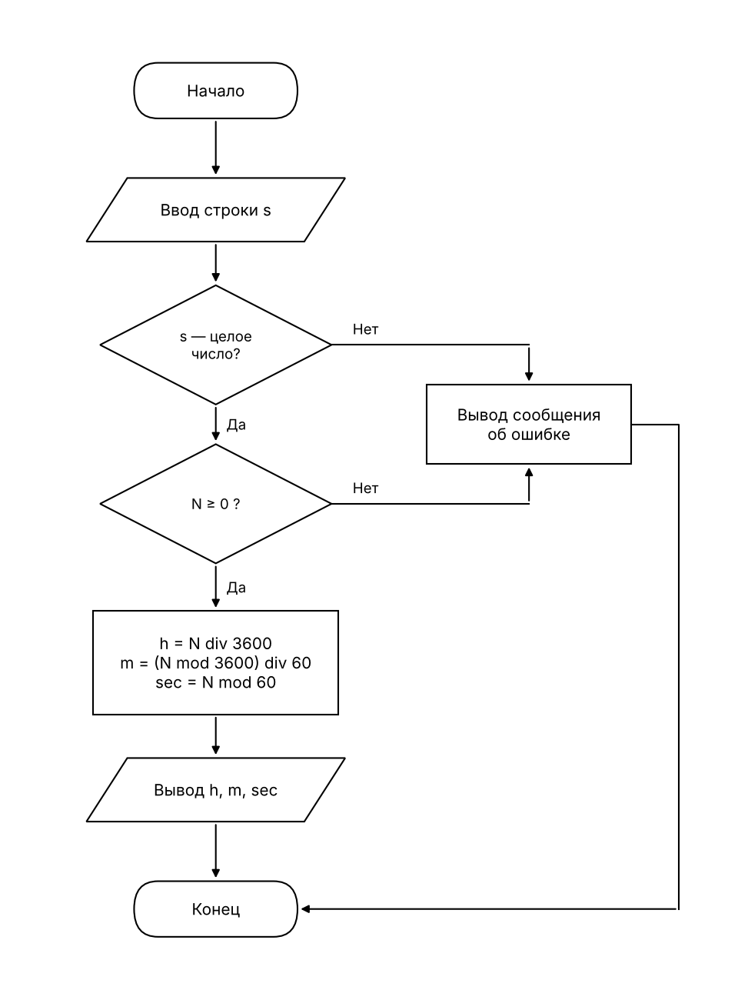

# Перевод секунд в часы, минуты и секунды

Дано целое число секунд N (N ≥ 0). Нужно перевести его в часы, минуты и секунды.

## 1. Словесная запись алгоритма

1. Начало.
2. Ввести строку s.
3. Если s не является целым числом, вывести сообщение об ошибке и перейти к шагу 10.
4. Преобразовать s в целое число N.
5. Если N < 0, вывести сообщение об ошибке и перейти к шагу 10.
6. Вычислить часы: h = N div 3600 (целочисленное деление).
7. Вычислить остаток после часов: r = N mod 3600.
8. Вычислить минуты: m = r div 60, и секунды: sec = r mod 60.
9. Вывести h, m, sec.
10. Конец.

## 2. Псевдокод

```
алг СекундыВЧМС
нач
    ввод s
    если s не целое число то
        вывод "Ошибка: введено не целое число"
    иначе
        N := целое(s)
        если N < 0 то
            вывод "Ошибка: число отрицательное"
        иначе
            h   := N div 3600
            r   := N mod 3600
            m   := r div 60
            sec := r mod 60
            вывод h, m, sec
        все
    все
кон
```

## 3. Блок-схема (ГОСТ 19.701-90)



## 4. Программа

Файл [Program.cs](Program.cs), запуск: `dotnet run`.
Некорректный ввод (текст, пустая строка, дробное число, отрицательное число) приводит к сообщению об ошибке, программа не падает.

## 5. Результаты проверки

| Ввод  | Вывод                    | Проверка                      |
|-------|--------------------------|-------------------------------|
| 3725  | 3725 с = 1 ч 2 мин 5 с   | 3600 + 2·60 + 5 = 3725        |
| 59    | 59 с = 0 ч 0 мин 59 с    | меньше минуты                 |
| 86399 | 86399 с = 23 ч 59 мин 59 с | 23·3600 + 59·60 + 59 = 86399 |
| 0     | 0 с = 0 ч 0 мин 0 с      | граничный случай              |

Дополнительно (некорректный ввод):

| Ввод | Вывод                                            |
|------|--------------------------------------------------|
| -5   | Ошибка: число секунд не может быть отрицательным. |
| abc  | Ошибка: введено не целое число.                  |
