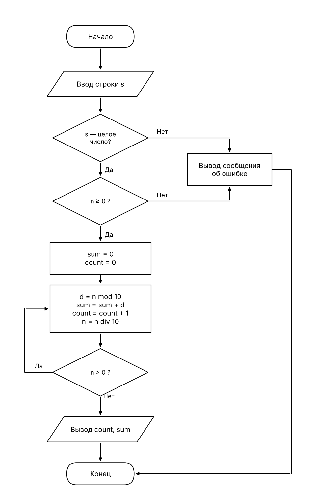

# Количество цифр числа и их сумма

Дано целое число n (n ≥ 0). Найти, сколько в нём цифр и чему равна их сумма.

**Какой цикл нужен для n = 0.** У числа 0 одна цифра. Цикл `пока n > 0` для нуля не выполнился бы ни разу и дал бы «0 цифр». Поэтому нужен цикл с постусловием (`do ... while`): тело выполняется хотя бы один раз, а условие `n > 0` проверяется после него.

## 1. Псевдокод

```
алг ЦифрыЧисла
нач
    ввод s
    если s не целое число то
        вывод "Ошибка: введено не целое число"
    иначе
        n := целое(s)
        если n < 0 то
            вывод "Ошибка: число отрицательное"
        иначе
            сумма := 0
            количество := 0
            повторять
                цифра := n mod 10
                сумма := сумма + цифра
                количество := количество + 1
                n := n div 10
            пока n > 0
            вывод количество, сумма
        все
    все
кон
```

## 2. Блок-схема (ГОСТ 19.701-90)



## 3. Ручная трассировка

Значения указаны после выполнения тела цикла. Строка «0» показывает состояние до цикла.

**n = 472**

| Итерация | n   | сумма | количество | условие цикла (n > 0) |
|----------|-----|-------|------------|-----------------------|
| 0 (до цикла) | 472 | 0 | 0 | — |
| 1 | 47 | 2  | 1 | истина |
| 2 | 4  | 9  | 2 | истина |
| 3 | 0  | 13 | 3 | ложь, выход |

Результат: цифр 3, сумма 13.

**n = 0**

| Итерация | n | сумма | количество | условие цикла (n > 0) |
|----------|---|-------|------------|-----------------------|
| 0 (до цикла) | 0 | 0 | 0 | — |
| 1 | 0 | 0 | 1 | ложь, выход |

Результат: цифр 1, сумма 0.

## 4. Программа

Файл [Program.cs](Program.cs), запуск: `dotnet run`.
Не число, дробное число, пустая строка и отрицательное число дают сообщение об ошибке, программа не падает.

## 5. Результаты проверки

| Ввод | Вывод | Проверка |
|------|-------|----------|
| 472  | цифр = 3, сумма цифр = 13 | 4 + 7 + 2 = 13 |
| 0    | цифр = 1, сумма цифр = 0  | цикл выполнился один раз |
| 7    | цифр = 1, сумма цифр = 7  | |
| 1000 | цифр = 4, сумма цифр = 1  | 1 + 0 + 0 + 0 = 1 |

Некорректный ввод:

| Ввод | Вывод |
|------|-------|
| -5   | Ошибка: число не может быть отрицательным. |
| abc  | Ошибка: введено не целое число. |
