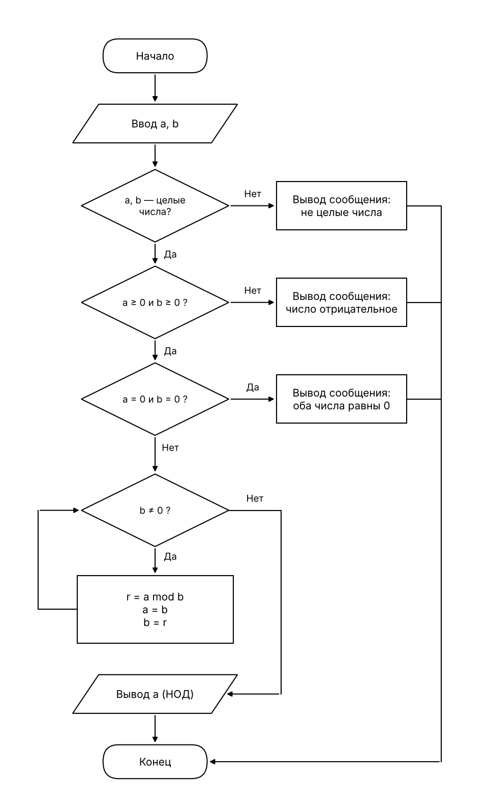

# t03: алгоритм Евклида (НОД)

Алгоритм задан псевдокодом:

```
ввод a, b (a ≥ 0, b ≥ 0, не оба равны нулю)
нц пока b ≠ 0
    r := a mod b
    a := b
    b := r
кц
вывод a
```

## 1. Блок-схема (ГОСТ 19.701-90)



Решения на схеме: Д1 «a, b — целые числа?», Д2 «a ≥ 0 и b ≥ 0?», Д3 «a = 0 и b = 0?», Д4 «b ≠ 0?» (цикл с предусловием).

## 2. Таблица тестов

Ожидаемый результат определён по схеме до запуска программы. Столбец «Факт» заполняется после прогона `run_tests.ps1` (или `run_tests.sh`) из папки `t03/Gcd`.

| № | Что проверяет | a | b | Ожидаемый результат | Факт |
|---|---------------|---|---|---------------------|------|
| 1  | Д1 «нет»: первое значение не число | abc | 5 | Ошибка: введены не целые числа. | |
| 2  | Д1 «нет»: второе значение дробное | 5 | 3.5 | Ошибка: введены не целые числа. | |
| 3  | Д1 «нет»: пустая строка | (пусто) | 4 | Ошибка: введены не целые числа. | |
| 4  | Д2 «нет»: a < 0 | -4 | 6 | Ошибка: числа должны быть неотрицательными. | |
| 5  | Д2 «нет»: b < 0 | 6 | -4 | Ошибка: числа должны быть неотрицательными. | |
| 6  | Д3 «да»: оба нули | 0 | 0 | Ошибка: оба числа равны нулю. | |
| 7  | Д4 «нет» сразу: ноль итераций | 7 | 0 | НОД = 7 | |
| 8  | Одна итерация, a = 0 | 0 | 5 | НОД = 5 | |
| 9  | Обычный случай, 3 итерации | 48 | 18 | НОД = 6 | |
| 10 | a < b (первая итерация меняет числа местами) | 18 | 48 | НОД = 6 | |
| 11 | Взаимно простые числа | 17 | 5 | НОД = 1 | |
| 12 | Равные числа | 5 | 5 | НОД = 5 | |
| 13 | Классический пример | 1071 | 462 | НОД = 21 | |

Все выходы всех решений покрыты: Д1 «да» и «нет» (тесты 1–3 и остальные), Д2 «нет» по каждому из операндов (4, 5) и «да», Д3 «да» (6) и «нет», Д4 «нет» при нуле итераций (7) и после итераций (8–13), Д4 «да» (8–13).

## 3. Трассировка при a = 48, b = 18

| Итерация | a (до) | b (до) | r = a mod b | a (после) | b (после) | b ≠ 0 |
|----------|--------|--------|-------------|-----------|-----------|-------|
| 0 (вход в цикл) | 48 | 18 | — | — | — | истина |
| 1 | 48 | 18 | 12 | 18 | 12 | истина |
| 2 | 18 | 12 | 6  | 12 | 6  | истина |
| 3 | 12 | 6  | 0  | 6  | 0  | ложь, выход |

Вывод: a = 6, то есть НОД(48, 18) = 6.

## 4. Проект

Проект `t03/Gcd` (файлы `Program.cs`, `Gcd.csproj`) написан по схеме: один блок кода на каждый блок схемы. Входные данные для прогона лежат в `tests.csv`.

Запуск одного теста: `dotnet run`. Прогон всех тестов: `.\run_tests.ps1` (Windows PowerShell) или `sh run_tests.sh`.
