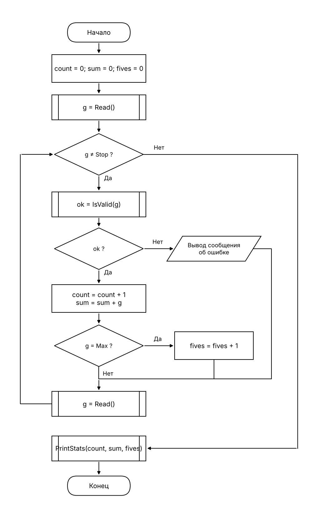

# t04: «Статистика оценок», разбиение на методы

Программа читает оценки (по одной в строке) до значения 0, считает допустимые оценки (от 2 до 5), их сумму и количество пятёрок и выводит итог.

## 1. Структура

Файл `GradesStats/Program.cs`: сначала инструкции верхнего уровня, затем `static class Grades`.

| Элемент | Назначение |
|---------|-----------|
| `const int Min = 2` | нижняя граница оценки |
| `const int Max = 5` | верхняя граница оценки (она же «пятёрка») |
| `const int Stop = 0` | значение-признак конца ввода |
| `int Read()` | читает оценку; нечисловой ввод возвращает как -1 |
| `bool IsValid(int g)` | истина, если `Min ≤ g ≤ Max` |
| `void PrintStats(int count, int sum, int fives)` | выводит итог или «Оценок нет» |

Конец входного потока (`ReadLine()` вернул `null`) `Read()` трактует как `Stop`, чтобы программа не зациклилась.

## 2. Схема верхнего уровня (ГОСТ 19.701-90)

Вызовы `Read()`, `IsValid(g)` и `PrintStats(...)` показаны символом «предопределённый процесс».

## 3. Тесты

Ввод: каждое значение с новой строки. Ожидаемый вывод записан по схеме до запуска; файлы лежат в `GradesStats/tests/`.

| № | Ввод | Ожидаемый вывод (после строки-приглашения) |
|---|------|--------------------------------------------|
| 1 | 5, 4, 5, 0 | `Оценок: 3, средний балл: 4.67, пятёрок: 2` |
| 2 | 0 | `Оценок нет` |
| 3 | 3, 7, abc, 2, 0 | две строки `Некорректная оценка, нужно число от 2 до 5.` (для 7 и для abc), затем `Оценок: 2, средний балл: 2.50, пятёрок: 0` |

Прогон: `.\run_tests.ps1` (PowerShell) или `sh run_tests.sh` из папки `GradesStats`.
